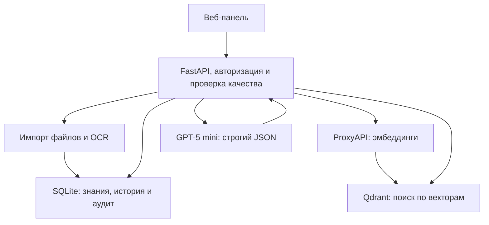

# Отчёт по выпускному проекту ZAG Atlas

**Знания компании. Ответы с источниками.**

Автор: Денис. Дата: 18 ноября 2026 года. Выпускной проект по курсу: Профессия – вайб-кодер.

Я выбрал вариант 5 — «Система знаний команды: поиск по своим данным + память». Реализовал веб-помощника для менеджера компании по установке и обслуживанию кондиционеров. Демонстрационная компания «Климат Сервис», документы и ситуации вымышлены.

Рабочая версия прошла локальную ручную приёмку. Дополнение от 18 ноября: подготовлен серверный установщик; его локальные проверки завершены, полный запуск на VPS с настоящим HTTPS пока не выполнялся. Отчёт составлен по исходному шаблону урока и дополнительному техническому заданию варианта 5. Демо и защита записаны автором; ссылки приведены в разделе 14. Итоговая сверка требований и границы подтверждений — verification/FINAL_SUBMISSION_REVIEW_20261118.md.

## 1. Ценность: для кого и зачем

Менеджер ищет цену, правила приёма заявки или порядок гарантийного обращения в нескольких документах. Новичку трудно понять, где актуальная инструкция; руководителю приходится повторять одни и те же объяснения. Неподтверждённое обещание клиенту может оказаться ошибочным.

Я собрал одну точку доступа к внутренним материалам. Сотрудник задаёт вопрос обычным языком и получает ответ с цитатами и переходом к документу. Если сведений не хватает, Atlas показывает, что именно нужно уточнить, и сохраняет причину в истории и аудите. Проверка источников остаётся частью работы сотрудника.

Одно развёртывание обслуживает одну компанию. Для другого бизнеса можно использовать ту же программу с отдельной базой, собственными документами, названием и описанием. Переключение компаний внутри одной установки не реализовано.

## 2. Три сценария пользователя

| Сценарий | Действия | Результат |
|---|---|---|
| Добавить знания | Администратор вводит название и текст заметки либо загружает DOCX/PDF/TXT/MD, проверяет предпросмотр и подтверждает сохранение | Документ появляется в списке с названием, временем, ID и учётной записью добавившего; текст можно открыть |
| Получить подтверждённый ответ | Сотрудник спрашивает «Сколько стоит стандартный монтаж?» | Ответ о 12 000 рублях, точная цитата и ссылка на документ; needs_review=false |
| Получить ручную проверку | Сотрудник спрашивает о персональной скидке Иванову, которой нет в материалах | Безопасный ответ, needs_review=true, причина и следующий шаг; запись доступна в истории и аудите |

Дополнительно я реализовал частичный ответ. На вопрос «Сколько стоит стандартный монтаж и есть ли гарантия?» Atlas показывает подтверждённую цену и состав монтажа, а наличие и условия гарантии выделяет как неподтверждённую часть. Весь запуск остаётся needs_review=true. «Не подтверждено в найденных материалах» не означает «гарантии нет».

Пополнение знаний проверено отдельным эпизодом: сначала расписания в базе не было; после добавления учебного файла 06 система нашла свободные окна. Старый запуск остался в истории. Это учебное расписание, а не подключение к актуальному календарю бригад.

## 3. Архитектура: семь блоков



При добавлении материала я извлекаю текст, показываю предпросмотр, затем сохраняю документ и его фрагменты. Векторный индекс строится по этим фрагментам. При вопросе сервер объединяет лексические и семантические результаты, формирует ограниченный контекст для модели, проверяет JSON и цитаты, сохраняет результат. Ответ и аудит доступны из веб-панели.

SQLite хранит исходные знания и историю. Qdrant хранит поисковый индекс; эмбеддинги создаёт отдельная модель через ProxyAPI. Compose запускает приложение и Qdrant с отдельными постоянными томами. Регистрация в облаке Qdrant не нужна. Наружу опубликован только локальный порт приложения 127.0.0.1:8000; порт Qdrant не опубликован на хост.

### Почему я усложнил поиск

В задании достаточно поиска по словам. Я добавил гибридный RAG, чтобы проверить поиск при других формулировках вопроса, сохранив лексический поиск для точных обозначений. Списки результатов объединяются через RRF.

На одной базе из шести документов и 39 фрагментов я сравнил два заранее выбранных вопроса:

| Вопрос | Текущая реализация поиска по словам | Гибридный поиск после успешного обращения к API |
|---|---|---|
| «Можно передвинуть приезд мастера?» | 0 фрагментов, ручная проверка | Правила переноса заявки с цитатами, needs_review=false |
| «Сколько стоит поставить сплит-систему?» | 0 фрагментов, ручная проверка | Цена стандартного монтажа с цитатой, needs_review=false |

Доказательство: [сравнение поиска](verification/SEARCH_JUSTIFICATION_20261116.json). Первая попытка завершилась сетевой ошибкой и не засчитана как успех. Два примера подтверждают пользу эмбеддингов в этих случаях, а не превосходство на всех вопросах. Более качественный лексический поиск тоже может дать улучшение.

Отдельная векторная БД не обязательна для 39 фрагментов: сравнивать векторы можно и более простым способом. Qdrant я выбрал как самостоятельный компонент индекса с постоянным хранением и возможностью восстановления. Нагрузочного преимущества этот эксперимент не доказывает. Цена решения — второй контейнер, синхронизация индекса, платные эмбеддинги и дополнительная внешняя зависимость.

## 4. Точки доступа API

| Обязательная команда | Вход | Назначение и результат |
|---|---|---|
| POST /kb/documents | title, text | Создаёт документ и фрагменты; возвращает status и document_id |
| GET /kb/documents | Без тела | Список документов для витрины |
| POST /kb/ask | question | Поиск по базе и ответ: answer, sources с document_id и quote, needs_review; дополнительные служебные поля — причина, признак технического отказа, ID запуска |
| POST /ai/answer_with_sources | question, context | Отдельная ИИ-операция; четыре публичных поля строгого результата |

Дополнительные команды обеспечивают интерфейс: POST /kb/documents/upload — предпросмотр файла, GET /kb/documents/{ident} — текст документа, DELETE /kb/documents/{ident} — удаление, GET /kb/history и /kb/history/{ident} — история и карточка, GET /audit/runs — аудит, GET/PUT /settings — настройки, GET /kb/export — JSON/CSV, POST /kb/reindex — восстановление индекса.

Авторизация: POST /auth/login, POST /auth/logout, POST /auth/change-password, GET /session. Управление сотрудниками: GET/POST /admin/users, PUT /admin/users/{username}, POST /admin/users/{username}/reset-password. Права проверяются сервером, а не только видимостью кнопок.

Все три обязательных POST-примера для README проверены с реальной моделью: [результаты curl](verification/README_CURL_RESULTS_20261116.json). После введения персональных сессий отдельно проверены вход, смена пароля и запросы: [сессионная проверка](verification/SESSION_CURL_RESULTS_20261116.json).

## 5. Схема данных

| Таблица или хранилище | Что хранится |
|---|---|
| documents | id, created_at, title, text; дополнительно created_by, filename, method, warnings |
| snippets | id, created_at, document_id, snippet_text; связь с documents |
| qa_runs | id, created_at, question, answer, sources_json, needs_review, error; дополнительно confidence и created_by |
| audit_runs | id, created_at, action, input, output, status, error, duration_ms |
| users, sessions, login_failures | Персональные учётные записи, серверные сессии, учёт неудачных попыток входа |
| Кеш эмбеддингов в SQLite | Повторное использование уже вычисленных векторов |
| Коллекция Qdrant | Векторы фрагментов и идентификаторы для поиска |
| settings.json в томе приложения | Профиль компании, лимиты и сроки сессий |

sources_json содержит массив document_id + quote. Пустые источники требуют needs_review=true. При частичном ответе источники могут быть непустыми и подтверждать только самостоятельную часть вопроса. История фиксирует результат на момент запуска; старые записи не переписываются при пополнении базы.

## 6. ИИ-операция

Профиль по умолчанию: openai/gpt-5-mini через ProxyAPI для ответа; openai/text-embedding-3-small для эмбеддингов. Модели задаются серверными настройками окружения, ключ не передаётся браузеру.

### Схема JSON

Публичный результат POST /ai/answer_with_sources:

```json
{
  "answer": "Учебная базовая стоимость стандартного монтажа составляет 12000 рублей.",
  "sources": [
    {"quote": "Учебная базовая стоимость стандартного монтажа составляет 12000 рублей."}
  ],
  "confidence": "high",
  "needs_review": false
}
```

answer — строка; sources — массив объектов со строкой quote; confidence — high, medium или low; needs_review — boolean. Схема строгая, с обязательными полями и запретом лишних полей. Структуру проверяю Pydantic на сервере.

Внутренний ответ модели дополнительно содержит review_details: вид проверки и missing_information. Сервер использует их для понятной причины и следующего шага; это не пятое поле публичного результата ИИ-команды. При частичном ответе подтверждённую часть составляю из дословно проверенных цитат, а не из свободного текста модели.

### Температура и другие параметры

Параметр temperature для GPT-5 mini в запрос не передаю. Числовое значение температуры в отчёте не приписываю: использую поведение выбранного API без этого параметра. В коде по умолчанию reasoning_effort=low, max_completion_tokens=4000; значения можно изменить через LLM_REASONING_EFFORT и LLM_MAX_COMPLETION_TOKENS. Это не делает ответы детерминированными.

### Когда нужна ручная проверка

Источники отсутствуют, confidence=low, ответ требует домыслов, материалы противоречат друг другу либо подтверждена только часть вопроса. Возвращаю needs_review=true, безопасный текст и конкретную причину, сохраняю их в qa_runs и audit_runs. Если причина касается отсутствия сведений, она относится к найденным материалам, а не ко всему, что существует в компании.

Сетевой отказ, таймаут или непригодный ответ сервиса также дают безопасный результат, но отмечаются как техническая ошибка. В такой ситуации сотруднику предлагается повторить запрос позже или обратиться к администратору; технический сбой не выдаётся за доказательство отсутствия знаний.

## 7. Память и контекст

Память команды — это сохранённые документы, фрагменты, индекс, история вопросов и аудит. Она сохраняется между перезапусками в томах Docker. История не используется как автоматически достоверный источник: знания берутся из документов, которые добавил администратор.

Поиск возвращает ограниченный набор фрагментов; модель получает вопрос и найденные тексты, а не все файлы без разбора. По умолчанию бюджет контекста — 20 000 символов. Описание компании в настройках не заменяет документ с правилами или ценами.

Текстовые PDF читаются напрямую. Для сканов используется Tesseract с русским и английским языками внутри образа. Предпросмотр позволяет заметить ошибку OCR до сохранения. Изображения и схемы семантически не анализируются. OCR не вызывает платный OCR API; после сохранения текста оплачиваются обычные эмбеддинги, а при вопросе — эмбеддинг запроса и работа модели ответа.

## 8. Контроль качества и доказательства

На входе проверяю типы, обязательные значения, пустые строки, размеры текста и файлов, поддерживаемый формат, права пользователя. По умолчанию: название — 200 символов, документ — 100 000, вопрос — 2 000, файл — 10 МБ; администратор может менять допустимые значения через интерфейс. Ошибки лимита видимы, документ молча не обрезается.

На выходе проверяю завершённость ответа API, отсутствие отказа модели, корректность JSON, схему, допустимые значения confidence и цитаты. quote должна дословно входить в переданный контекст, а у /kb/ask — принадлежать найденному фрагменту документа. Проверка точного совпадения не доказывает логически, что все выводы следуют из цитаты; релевантность и полноту ответа также нужно оценивать.

| Проверка | Результат и граница |
|---|---|
| Обязательные данные | Пять документов по 21 строке в tests_data/kb_documents.jsonl; десять вопросов в tests_data/kb_questions.jsonl: семь известных и три неизвестных; таблица ожиданий в README |
| Контрольный живой прогон | 10/10 по статусу проверки и наличию источников на исходных пяти документах; [результат](verification/LIVE_TEST_RESULTS.json) |
| Офлайн-тесты | Последний полный прогон 18 ноября — 99 без ошибок, включая проверки установщика, восстановления admin и один запуск десяти сетевых сценариев JavaScript; [журнал](TEST_RESULTS.txt) |
| Нет источников / низкая уверенность | QualityTests.test_sources_required, test_low_confidence_forces_review, test_invented_quote_rejected, test_empty_context_no_external_call; ApiTests.test_no_documents_review_and_reason проверяет сохранение причины |
| Противоречие и инструкция внутри документа | Модель не выбрала произвольную цену и не приняла навязанную скидку; это подготовленные примеры, а не доказательство защиты от всех атак |
| Частичный ответ | Проверены конкретный пробел, проверенные цитаты, следующий шаг, история, аудит, экспорт и восстановление завершённого запроса; [итог](verification/REVIEW_DETAILS_RESULT_20261117.md) |
| Импорт и OCR | Текст пяти файлов, один читаемый русский скан, неверный PDF, неподдерживаемый формат и превышение размера; [результат](verification/IMPORT_OCR_RESULTS.json). Ручной предпросмотр скана принят без добавления дубликата |
| Персональные учётные записи | Создание staff администратором, временный пароль, обязательная смена, показ/скрытие пароля, минимум 8 символов, ошибка несовпадения, выход, блокировка и сброс |
| Ручная приёмка и экспорт | Загрузка и открытие документов, ответы, история, аудит, роли и читаемость кириллицы/столбцов в JSON/CSV подтверждены автором; [приёмка](verification/MANUAL_ACCEPTANCE.md) |
| Чистый запуск | Отдельные исходники, пустые SQLite/Qdrant, build --no-cache --pull; инфраструктура готова за 134,195 с, функции проверены за 142,498 с; [итог](verification/CLEAN_START_RESULT_20261117.md) |

Чистый запуск — разрешённая уроком имитация на компьютере с установленными Docker/WSL; базовые слои могли быть в кеше. Установка Docker/WSL и ручная настройка ключа не включены в время. Рабочие контейнеры и их подключения не изменены, тестовые ресурсы удалены. Это не проверка с нуля на новом компьютере и не замер последней правки промпта.

На текущей базе уже есть шестой файл с расписанием, поэтому исходный неизвестный вопрос №8 теперь может получить ответ. Для воспроизведения базового 7/3 использую исходные пять документов в отдельном окружении; в рабочей демонстрации неизвестным остаётся вопрос о персональной скидке. Полноту всех возможных вопросов не заявляю.

Аудит в SQLite хранит вход, выход, статус, ошибку, время и длительность. Технические JSON-логи в stdout помогают связать HTTP-запрос, поиск, импорт/OCR и модель через request_id. Секреты и полные тела документов в технический поток не записываются; Docker ограничивает размер файлов логов. История и аудит сами содержат рабочие тексты, поэтому доступ к ним и резервным копиям требует контроля.

## 9. План внедрения за один день

Это план пилота для небольшой компании при заранее подготовленных Docker, ключе и ответственном за материалы; не обещание внедрения любого архива за день.

| Время | Действие | Критерий готовности |
|---|---|---|
| 09:00–10:00 | Развернуть отдельный экземпляр, задать секреты, сменить первоначальный пароль, заполнить профиль | Администратор входит, данные относятся к одной компании |
| 10:00–12:00 | Отобрать актуальные инструкции, удалить из пилотных материалов лишние персональные данные, загрузить и проверить OCR | Документы открываются, текст и происхождение проверены ответственным |
| 12:00–14:00 | Составить минимум десять контрольных вопросов: известные, неизвестные, неоднозначные | Ответы и ручные проверки соответствуют ожиданиям; спорные материалы уточнены |
| 14:00–15:00 | Создать сотрудников, передать временные пароли безопасным каналом, показать источники и ручную проверку | Сотрудник меняет пароль и выполняет основной сценарий |
| 15:00–17:00 | Провести пилот, назначить порядок разбора вопросов без ответа, определить резервное копирование и проверить восстановление | Компания принимает сценарий, знает ответственного и порядок сопровождения |

Публичное серверное размещение в выпускном задании не обязательно. Подготовленная серверная конфигурация использует отдельный HTTPS-прокси Caddy и собственные тома; её наличие не означает выполненный деплой. Перед реальным удалённым доступом отдельно настраиваются HTTPS, резервное копирование, эксплуатационный доступ и проверка ограничений конкретного заказчика. Эти работы не выдаю за уже выполненный серверный деплой.

## 10. Мини-экономика

16 ноября я сравнил одну операцию: найти действия менеджера при гарантийном обращении. Вручную получилось 180 секунд; с Atlas, включая чтение ответа, — 23 секунды. Серверное время по аудиту составило 6,333 секунды и не подменяет полное время человека. Один пример не даёт средней скорости; после ручного поиска я уже был знаком с материалом.

Оценка API для сохранённого запроса: 782 входных и 401 выходной токен GPT-5 mini плюс 45 токенов эмбеддинга вопроса. При сохранённых тарифах ProxyAPI от 16 ноября это 0,2579782 ₽. Токены рассуждения уже включены в выход и второй раз не прибавляются. Это расчёт по usage и тарифам, не проверенное списание со счёта.

| Показатель | Вручную | С Atlas |
|---|---:|---:|
| Одна операция | 3 минуты | 0,383 минуты, или 23 секунды |
| 100 похожих операций, расчёт | 5 часов | 38 минут 20 секунд |
| Труд по условной ставке 600 ₽/час | 3 000 ₽ | 383,33 ₽ |
| API для 100 таких запросов | 0 ₽ | Около 25,80 ₽ |
| Труд + API | 3 000 ₽ | Около 409,13 ₽ |

Расчётная разница — 4 часа 21 минута 40 секунд и около 2 590,87 ₽ на сто таких операций. Это оценка высвобожденного времени при условной ставке, а не доказанная экономия бюджета. Серия из ста операций не выполнялась. Инфраструктура, внедрение, сопровождение, подготовка базы и резервные копии в сумму не включены.

Документы учебные и короткие. При длинных инструкциях сотруднику может потребоваться больше времени даже с поиском по словам; найденное совпадение не гарантирует полноту. Рост экономии на больших архивах я не измерял. Замер также выполнен до последней доработки промпта и пояснений; повторных времени и usage той же операции на текущей версии нет.

Ценность проверенного случая — более быстрое получение ответа с проверяемыми источниками. Коммерческий вариант предполагает отдельное внедрение для одной компании и сопровождение; цену, окупаемость и тарифную сетку пока не подтверждал пилотом. Все формулы, тарифы и ограничения вынесены в [ECONOMICS.md](ECONOMICS.md).

## 11. Риски и меры снижения

| Риск | Что сделал / что требуется |
|---|---|
| Модель выдумывает факт или источник | Строгая схема, проверка точных цитат и принадлежности фрагментам, безопасная ручная проверка; семантическая проверка всех выводов не гарантирована |
| Не найдена важная часть ответа | Гибридный поиск, ограниченный контекст, отдельное пояснение пробела и следующий шаг; нужны контрольные вопросы конкретной компании |
| Противоречивые или устаревшие документы | Проверенный сценарий конфликта не выбирает цену произвольно; актуальность и приоритет материалов устанавливает ответственный сотрудник |
| Инструкция-атака внутри документа | Материалы передаются как данные; подготовленный пример проверен. Полной защиты от любых prompt injection не заявляю |
| Ошибка OCR | Предпросмотр, предупреждение и подтверждение сохранения; проверен один читаемый скан, не точность любых фотографий |
| ProxyAPI или Qdrant недоступны | Таймауты, безопасный технический результат, причина в истории/аудите и request_id в диагностике. Длительная доступность сервиса не измерялась |
| Утечка секретов и рабочих текстов | Серверный .env, пример без ключей, персональные роли, защищённые пароли и сессии, безопасные технические логи. Внешнему провайдеру передаётся найденный контекст; допустимость этого определяет заказчик |
| Доступ не того сотрудника | Учётные записи создаёт администратор, обязательная смена временного пароля, блокировка, сброс и выход. По умолчанию 30 минут без запросов и максимум 8 часов; администратор меняет сроки. Разделения документов по отделам нет |
| Потеря пароля admin | Владелец установки запускает `python -m app.recover_admin` через терминал при остановленном приложении: скрытый временный пароль, отзыв сессий, обязательная смена, атомарный аудит. Проверено на временной базе; внутри Docker и на VPS пока не проверялось |
| Потеря данных или рассинхронизация индекса | Постоянные тома, проверка сохранения и возможность переиндексации; эксплуатационные резервные копии и восстановление нужно организовать при внедрении |
| Расходы и увеличение базы | Лимиты размеров и контекста, кеш эмбеддингов, учёт usage; для большого архива нужны отдельные нагрузочные и стоимостные проверки |

## 12. Три строки для портфолио

**Проблема:** менеджер тратит время на поиск внутренних правил, а неподтверждённые ответы клиенту создают риск ошибок.

**Решение:** я разработал ZAG Atlas — веб-базу знаний на FastAPI, SQLite и Qdrant с гибридным RAG, цитатами, понятной ручной проверкой, персональными сотрудниками и аудитом.

**Результат:** на учебных данных пройдены 10/10 контрольных вопросов и локальная приёмка; отдельная чистая установка проверена за 142,498 секунды, а один ручной поиск сократился со 180 до 23 секунд с оговорёнными границами замера.

## 13. Как запустить

[Репозиторий ZAG Atlas](https://github.com/Denis-Zag/ZAG-Atlas).

[README — запуск, переменные окружения, API, тестовые данные и curl](README.md). Для локального запуска нужны Docker Desktop с Linux Engine, Compose и рабочий ключ ProxyAPI. Для Linux-сервера подготовлен install.sh с вопросами о домене, ключе и первоначальном пароле; справка — [deploy/README.md](deploy/README.md), границы проверок — [результаты установщика](verification/INSTALLER_RESULTS.md). Первоначальный пароль администратора задаётся при создании установки и затем обязательно меняется. Название и описание компании вводятся через веб-панель; секреты — в серверном окружении.

## 14. Демонстрация

- [Демо ZAG Atlas](https://disk.yandex.ru/i/yeqlG7qqGTrTVA) — 5 мин 21 сек.
- [Защита ZAG Atlas](https://disk.yandex.ru/i/vF8l8ReHq6YUQQ) — 9 мин 57 сек.

Обе записи опубликованы автором 18 ноября 2026 года. Ссылки проверены без авторизации: доступны два MP4-файла. Длительности сообщил автор. В README размещено демо; обе записи доступны в этом разделе.

Основные кадры: [подтверждённый ответ](docs/screenshots/08_answer_current.png), [частичный ответ](docs/screenshots/10_partial_answer.png), [карточка аудита](docs/screenshots/12_audit_partial_detail.png), [персональные сотрудники](docs/screenshots/13_users.png). На более ранних кадрах профиль компании ещё не был заполнен; это не другая база или другая установка.

## 15. Сложности и как я их решал

Сначала поиск по словам не находил переформулировки. Я добавил эмбеддинги и Qdrant, сохранил лексический поиск и сравнил их на двух конкретных вопросах. Не стал выдавать маленький эксперимент за доказательство производительности на большом архиве.

Внешний API периодически возвращал сетевые ошибки. Я разделил отсутствие знаний и технический отказ, добавил диагностику и восстановление уже завершённого результата по request_id.

Первоначальная общая фраза «данных недостаточно» не объясняла оператору, чего именно не хватает. Я добавил конкретный пробел, проверенную часть ответа и следующий шаг, затем сократил лишние уточнения модели. Проверил сохранение результата в истории и аудите; пользователь принял результат через рабочую веб-панель.

Периодические /health заполняли последние сто строк аудита и скрывали нужный запрос. Я добавил фильтр вопросов до применения LIMIT и заметную метку needs_review. Старые записи при этом не удаляются.

Общие admin/staff-учётные записи не подходили для реального использования. Я добавил персональных сотрудников, серверные сессии, выход, временные пароли и обязательную смену. После ручной проверки уточнил минимум 8 символов, показ пароля и сообщение о несовпадении.

## 16. План развития

Первым шагом после сдачи я проведу пилот на материалах реальной компании: набор вопросов с эталонными источниками, оценка полноты, доли ручной проверки, задержки и затрат. Отдельно проверю длинные документы, сложные сканы и более разнообразные формулировки.

Следующие направления — версии и сроки актуальности документов, явное назначение ответственного за пробел, роли доступа к разделам знаний, резервное копирование и проверка восстановления, эксплуатационные метрики. Серверный деплой для портфолио обсудим после комментариев преподавателя. Новые функции в текущем отчёте не выдаются за реализованные.

Дополнение от 18 ноября: восстановление admin проверено 15 целевыми тестами; на этом этапе общий офлайн-прогон составлял 98 тестов без ошибок; актуальный итоговый прогон — 99 тестов. Рабочий пароль не менялся. Подтверждения: verification/ADMIN_RECOVERY_RESULTS.md.

Дополнение 18 ноября по пользовательским логам: сервер успешно сохранял ответы за 26,729 и 22,930 с, но браузер после обрыва прекращал поиск результата через четыре секунды. Я увеличил ожидание сохранённого результата до трёх минут с ограниченным временем отдельных GET-запросов, без повторного POST. Проверки — verification/BROWSER_RECOVERY_RESULTS_20261118.md. Первопричина обрыва соединения не установлена. При итоговой сверке работающий сайт отдаёт исправленный JavaScript, идентичный исходникам; автор сообщил о завершении записи демо. Намеренный повтор сетевого обрыва в рабочем браузере ассистентом не выполнялся.
